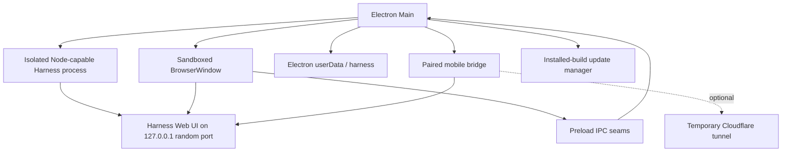

# DSH Desktop architecture

DSH Desktop is an Electron host for the existing DeepSeek Harness runtime and Web UI. It does not maintain a second agent runtime or reimplement the Harness frontend. This document is part of the [documentation index](README.md).

## Runtime topology



On macOS, Harness runs in an Electron UtilityProcess with Node capabilities. On Windows, it is launched from the packaged Electron executable in Node mode (`ELECTRON_RUN_AS_NODE=1`); Package commands outside Harness (Profile repair, market baseline, generation installs and the `.desktop-bin` `node`/`pnpm` shims) use the same Electron runtime with `ELECTRON_RUN_AS_NODE=1` — the app's Helper on macOS, the main executable on Windows — and neither platform carries a standalone Node. Both paths reach Node internals through Harness's `node-addon-require-builtin`, which accepts only the Electron builds it was compiled for, so `scripts/verify-target.mjs` runs the same loader calls under the packaging Electron before every package build. Cordis HMR's `--expose-internals` permission is granted to that isolated process and never to the web renderer. On Windows the window uses a hidden title bar: Harness draws the 40 DIP caption row, and Desktop adds the "应用" / "编辑" caption menubar beside the sidebar toggle, whose native popups carry the Desktop commands.

## Startup flow

1. Configure a stable production or development application identity and user-data directory.
2. Acquire the single-instance lock.
3. Create the application-owned `launch-root` directory.
4. Open the startup surface and inspect the normal web profile.
5. Pin the profile's pnpm store and repair incomplete package state when needed.
6. Start Harness on an available `127.0.0.1` port with the tracked desktop patch layer.
7. Poll the endpoint until it remains healthy, then load it into the main window.
8. Start the paired mobile bridge and, in installed builds, the update manager.

Harness restarts reuse the same application-owned data. Safe Mode starts a separate profile containing official core bundles while leaving normal-profile plugins blocked.

## Persistent data

```text
Electron userData/
├── launch-root/                 Neutral Harness process working directory
├── harness/                     DSH_HOME
│   ├── profiles/                Normal and Safe Mode profiles
│   ├── sessions/                Conversation state
│   ├── settings.yaml            Harness-backed settings
│   └── plugins and package data
├── bin/                         Cached desktop helper binaries
├── desktop-service/             Crash-report outbox, and release-notes.json:
│                                the About page's offline copy of the running
│                                version's notes (updates and fixes only)
└── update-skip.json             Remembered update choice, when present

Electron logs/
└── harness.log                  Desktop and Harness startup diagnostics
```

Production and development builds use separate user-data roots. Application upgrades do not replace profile, plugin, workspace, session, or model configuration data.

## Window and IPC security

The main Harness window uses:

- `contextIsolation: true`
- `nodeIntegration: false`
- Electron renderer sandboxing
- web security enabled
- blocked webviews
- navigation and new-window restrictions
- a narrow permission allowlist

Only local Harness, packaged file, and desktop recovery URLs are trusted inside the app. Ordinary HTTP and HTTPS links are opened externally. IPC handlers validate the sending window and main frame before performing privileged actions such as opening the native directory picker, restarting Harness, managing Safe Mode, or installing an update.

## Profiles and plugin recovery

The normal web profile may contain community plugins and their transitive packages. Startup performs bounded consistency checks and can repair incomplete package operations before launching Harness.

When a plugin prevents startup or frontend rendering, the recovery path collects log and renderer evidence, resolves ownership through the profile manifest, lockfile, bundles, loader entry IDs, slot conflicts, dependencies, and Cordis patch rows, then offers a targeted action. Destructive profile changes require an explicit user action.

Safe Mode is non-destructive: it starts an isolated official-core profile, keeps the Agent and user data available, and allows the user to remove selected third-party plugins before returning to the normal profile.

Whether a profile plugin loads has one authority: the package switch in `profiles/web/.dsh-market/state.json#disabled`, read and written through `dsh-desktop-market-installer/plugin-state`. Harness boot skips a switched-off package before resolving it, and dsh-market, the official Plugin Manager (through the `profileBundlePackageBackend` `switched`/`removed` hooks), the workbench page, Recovery and Safe Mode all record their toggles there. `dsh.profile.bundles` is derived composability: launch projection and bundle healing may re-list an installed bundle without re-enabling it, except that a plugin with a pending removal is never re-listed and stays switched off until its removal commits. Every uninstall path forgets the switch so a reinstall starts enabled. Package ownership is separate: the generation registry owns plugins installed as generations; pnpm owns the shared-tree market and Profile-owned packages, so the generation backend declines those and Plugin Manager falls back to pnpm. Installing a generation over a Profile-owned directory completes at the next launch projection, because a loaded directory cannot be replaced in place.

After interrupted migration/restore gates, startup establishes the enabled market's compatible shared-tree baseline before migrating ordinary plugins. A deferred migration therefore cannot skip this baseline. Market installation keeps `.desktop-market-install-pending.json` until pnpm succeeds and the active package is verified; a partial install forces a retry even when its package version already looks current. The marker preserves the first pre-install manifest for diagnosis. Restoring that manifest on failure is not a rollback of the entire dependency tree.

For reused or deferred legacy trees, startup reads bundle manifests and YAML layers through Harness's own profile loader before launching. A bundle that is declared but no longer installed has its declaration removed once and the check retried, since disabling a plugin writes a patch row and cannot clear a manifest-level fault; this removes third-party declarations only, never core bundles, package files, user patch rows or plugin data. Inputs that are still invalid enter Safe Mode with plugin repair controls enabled, and the failing bundle is listed there. An incomplete migration/restore transaction still locks those controls; a newly rebuilt tree retains the existing real-launch/rollback verification. This preflight does not execute plugin code or prove successful activation. The native recovery manager is also opened if the recovery Harness fails, since shared settings can still affect both profiles.

A baseline market that cannot be installed — an offline or restricted network reports this as a pnpm fetch, 404 or EPERM failure — only blocks startup when the market already in the profile is absent, unreadable or still owned by a generation. Otherwise the boot continues on the installed market and the pending marker retries the repair on the next launch.

Safe Mode uses the installation anchor for both host plugin imports and client bundle discovery, without requiring `profiles/node_modules`. The paired `dsh-app-boot` / `dsh-client-modules` patches target the pinned Harness baseline (`0.2.1-rc.4` as of Desktop 0.0.3): `mountRootInclude` publishes the explicit host anchor on the loader using `Symbol.for("dsh.desktop.host-module-base-url")`, and client discovery consumes it for bare package names only. Configuration-relative paths and ordinary profiles keep their existing resolution. This loader handoff is needed because client discovery otherwise re-resolves from the Profile tree; remove both hunks when upstream propagates an equivalent resolution anchor. Regression coverage includes the actual recovery subprocess's authenticated HTML and executable bootstrap, plus path-resolution behavior tests.

Normal-profile Desktop patch insertions resolve from the actual bundled Harness entry, then use the same absolute source URLs for backend loading and client discovery. The patch file's directory is not a package anchor: installed patches live directly in `resources`, while runtime packages live in `resources/app.asar.unpacked/node_modules`. Missing host sources retain the package name, anchor and original resolution cause, and leave the previous generated patch intact.

## Mobile access boundary

Harness itself stays on a random loopback port. Phone access is provided by a separate bridge:

- The bridge listens on a dedicated LAN port.
- Pairing uses a short-lived random token. Wi-Fi scanning creates a session immediately. An internet tunnel also requires a 6-digit pairing password shown only on the desktop pairing window.
- The password is temporary (5 minutes, in memory) unless the user opts into a durable password stored in `mobile-pairing-pin.json`.
- Mobile API access requires an authorized session. Tunnel sessions are cookie-only; LAN sessions may also match a private remote address.
- Requests are restricted by origin, address, and connection state.
- Cloudflare Quick Tunnel is the usual remote path. Free Pinggy is the fallback when Cloudflare is unavailable and is expected to expire after about 60 minutes.

The public tunnel is optional and forwards only the paired mobile surface; it does not rebind the Harness service to a public interface.

## Updates

Installed builds use `electron-updater`. The app checks shortly after startup, every six hours, and after a long system resume. A newly available version is offered before download. Download begins only after user consent, and installation begins only when the user chooses to restart and install. Users can skip one version without suppressing later releases.

The update source is the public GitHub Releases API of `LightyearXizIl/DSH-Desktop` (`src/main/update/version-catalog.ts`). The client picks the newest non-draft release whose assets include the platform metadata (`latest.yml` on Windows), points the feed at that release's download directory, and offers that release's notes with the update. A stable installation ignores prereleases. Installing an older version from the history list temporarily enables downgrade for that one check and download.

Release notes reach the app filtered. `src/shared/release-notes.ts` keeps a release body's title line and its `## 更新内容` / `## 问题修复` sections (English equivalents too) and drops the rest — upgrade notes, known limitations, verification records, diagnostic paths — which stay on the GitHub Release page. The main process applies it before any renderer sees the text: in `reduceUpdateStatus` for every offered or downloaded update, and in `src/main/update/current-release-notes.ts` for the running version. The latter serves `desktop:release-notes` (preload `getReleaseNotes`) for Settings → About: it reads the GitHub Release by tag at most once per session, keeps a filtered copy in `<userData>/desktop-service/release-notes.json` and falls back to that copy offline; an unpublished development version has no notes rather than an error.

Two renderers lay the notes out. The preload update window parses the Markdown subset release notes use (headings, nested lists, paragraphs, bold, inline code) with the same shared module and builds the result from text nodes only; the compact notification shows the release's theme from the title line. The About section in `dsh-desktop-client-ui` shows a persistent, collapsed-by-default card for the running version — plus one for a newer version found by "Check for updates" — rendered with the upstream `MarkdownText` primitive. The release-notes section titles are therefore a contract with `RELEASE_NOTES.md`.

Windows installers are unsigned personal builds. `package.json` sets `win.verifyUpdateCodeSignature: false` and declares no `signtoolOptions.publisherName`, so packaged builds write no publisher into `resources/app-update.yml` and electron-updater skips the Authenticode check. Update integrity relies on the `sha512` in `latest.yml` and the HTTPS GitHub download.

The update and About dialogs are preload-owned surfaces mounted under
`document.body`, not `document.documentElement`, so they inherit Harness design
tokens. Mica mode renders them as glass cards with the official panel radius
and theme blur; compatibility mode and the disabled theme keep the official
solid card. `updatePercent()` is the single integer source for progress copy,
`aria-valuenow`, `aria-valuetext` and the visual fill width.

## Crash reporting

Packaged builds start `src/main/desktop-service` after the single-instance lock. Failures (`startup-failure`, `harness-crash`, `renderer-crash`, `gpu-crash`, `main-crash`) are queued under `<userData>/desktop-service/outbox` with the version, platform, failure kind and at most the last 100 redacted log lines; at most 50 reports are kept. Every report needs explicit consent in a native dialog before its single upload attempt, refusal discards it, and nothing is retried. A leftover session marker alone is not reported. The upload address in the current code is still the inherited `https://…/crash` endpoint (`SERVICE_URL` in `service.ts`), which this project does not operate; see the [known issues](README.md#已知遗留问题).

## Desktop customization boundary

Most of the product UI remains upstream Harness. DSH Desktop adds native host surfaces through Electron Main and preload code, uses Harness extension slots where available, and tracks unavoidable upstream package changes as reproducible `patch-package` files. This keeps the desktop layer reviewable while making upstream upgrades an explicit compatibility exercise.

The bundled `dsh-desktop-theme` plugin owns the glass appearance and its
settings page. Its source is split by lifecycle and effect ownership under
`packages/dsh-desktop-theme/src/client/`; `npm run theme:build` emits the single
ModuleLoader bundle consumed by both normal and Safe Mode profiles. The host
entry remains in `packages/dsh-desktop-theme/index.js`, and the generated
`lib/` output is not a second source tree. The theme's settings stylesheet
follows the plugin lifetime, while appearance styles, ambient layers, tokens,
wallpapers, and effect loops follow the enabled state. Spotlight decoration
must not change the active composer seat's upstream `sticky` positioning.
The glass wrapper must preserve the upstream sidebar width, padding, margin and
collapse position. Brand and New Session controls use explicit upstream marks
instead of a generic labelled-button seam. On Windows, the collapse toggle is
seated in the brand row ahead of the logo so it does not overlap the brand mark;
when collapsed, the zero-width sidebar column clears its card background and
filter so the fixed caption rail button remains unclipped.

Floating panes (sidebar column, active conversation header, composer card,
trajectory card) paint their glass on a `::before` plate, so no pane carries a
`backdrop-filter` of its own. The hover tilt writes an inline `transform` on the
whole pane so its text tilts with the card. Because a transform makes the pane
the containing block for its `position: fixed` descendants, the spotlight snaps
the pane flat as soon as a tooltip, menu, listbox or dialog mounts inside it and
does not tilt it again until that overlay is gone. The sidebar tilts with the
other panes, rests while the settings overlay is open over it, and never tilts
as the collapsed rail.

Liquid Glass publishes its material (tint, opacity floor, stroke, shadow, bubble,
switch colours) as theme override tokens with light and dark values, so panes
follow the active scheme without hand-written dark selectors. Pane opacity
starts at a legibility floor and frost only adds to it;
`test/desktop-theme-contrast.test.ts` checks text contrast over every fluid
bloom. Over the fluid the floor is fitted live to the chosen palette
(`glass-floor.ts`), and while a conversation is open a reading wash brightens
(light) or darkens (dark) the backdrop just enough for its bare text; image
wallpapers are sampled to size their veil and floor the same way
(`wallpaper-legibility.ts`). In mica mode pages float on one content pane. An active conversation's
transcript has no pane and reads on the backdrop under its floating header; the
trajectory view is its own glass card that ends above the composer. The hero
stays on the bare backdrop. Compatibility mode keeps the native columns and
gives the sidebar and center full-bleed glass.

The glass card is applied to the layout-owned sidebar column (`pI_x6G_sidebarCol`),
using `paintBox` to unwrap `display: contents` slot wrappers; the inner sidebar
root fills it and owns content padding. The center column itself stays
transparent so the fluid backdrop is continuous between the panes. The layout patch
renders `data-dsh-desktop-center` on `CenterColumn`; theme unmount must never
strip this attribute because React owns it and would not re-render it on
subsequent theme toggles.

Deep surfaces also expose the fluid backdrop: the trajectory view
(`data-dsh-desktop-trajectory` in `dsh-client-ui-trajectory`) and right sidebar
(`data-sidebar-right-session` in `dsh-client-ui-sidebar-right`) have their
`--dsw-alias-bg-layer-1` and base backgrounds re-pointed to transparent. The
Chat section heading aligns with the Workspace section header: no leading
glyph, a quiet section title, and actions ordered as search, collapse, and
new session at the end.

The bundled `dsh-startup-screen` plugin defaults to author credentials:
identity `NullPointer`, identity ID `007`, and access level `01`, configured
identically across host defaults, client fallback, and preview documents.

The shared `src/shared/assistant-speed.ts` module owns decode-speed derivation
and formatting. Harness patches use its unique formatter name for the
completed-answer action, and the composer statistics template appends the unit
exactly once.

Desktop-wide scrollbar hiding is a host UI policy, not a theme effect: the
client UI stylesheet hides visible scrollbars and clips page-level horizontal
overflow without disabling wheel or touchpad scrolling. Scrollable content
must remain reachable through normal scrolling.

Harness 0.1.7 introduced Profile composition entries in place of directory based `dsh-agent-presets`, and the pinned baseline retains that model. Before launching the normal web Profile, Desktop converts valid user directories into those entries, backs up the original tree and Profile patch, and leaves the original directories untouched. Safe Mode continues to resolve its bundled preset and client packages from the installation anchor; the recovery subprocess regression creates a default-preset session through the authenticated RPC with `profiles/node_modules` absent.
